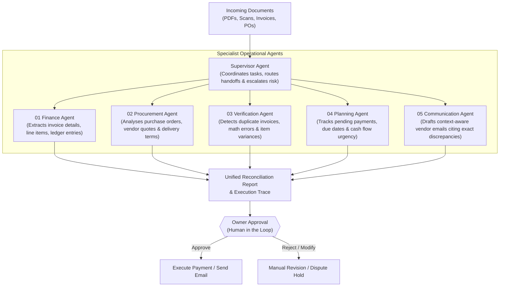

# FlowMind — Autonomous AI-Powered Business Operations

<div align="center">


### **One Coordinated Layer Between Business Documents and Decisions**

*Turn financial documents into actionable business decisions with coordinated AI agents.*  
*Invoices, purchase orders, discrepancy detection, and vendor communications handled in one unified, human-governed workflow.*

[](https://flowmind-ivory-delta.vercel.app)
[](./FLOWMIND.pptx)
[](LICENSE)
[](https://react.dev/)
[](https://www.typescriptlang.org/)
[](https://vitejs.dev/)
[](https://ai.google.dev/)

**[🌐 Live Demo](https://flowmind-ivory-delta.vercel.app)** • **[📊 Download Deck (PPTX)](./FLOWMIND.pptx)** • **[🚀 Quick Start](#-getting-started)** • **[🤖 Multi-Agent Architecture](#-multi-agent-architecture)** • **[🔄 Workflow & Case Study](#-example-workflow--overbilling-case-study)** • **[🛡️ Governance](#%EF%B8%8F-human-in-the-loop-governance)** • **[📡 Backend API](#-backend-api-endpoints)**

</div>

---

## 📌 The Problem & The Bottleneck

Small teams and growing businesses run finance across too many disconnected tools:
- **Scattered Inflow**: Invoices arrive as PDFs, mobile photos, physical scans, and email attachments.
- **Siloed Records**: Purchase orders sit in spreadsheets; actual payments occur in banking portals.
- **Delayed Discovery**: Duplicate invoices, quantity mismatches, and unexpected pricing drift surface weeks later during month-end closing.
- **Manual Chasing**: Deadlines, vendor inquiries, and invoice clarification emails are chased by hand.

> **The Bottleneck:** The business owner or finance operator becomes the manual integration layer — constantly re-keying the exact same numbers across four or five isolated systems.


---

## 🎯 The FlowMind Platform

FlowMind is a single coordinated layer between business documents and financial decisions. It unifies ingestion, validation, matching, and vendor communications into a transparent, audit-ready operating rhythm.

```
  ┌─────────────────┐       ┌────────────────────────┐       ┌────────────────────────┐
  │   01. INTAKE    │  ──▶  │    02. RECONCILE       │  ──▶  │       03. ACT          │
  │ PDFs, Scans,    │       │ 2-Way & 3-Way Matching │       │ Discrepancy Drafts,    │
  │ Email Inboxes   │       │ Duplicate Detection    │       │ Owner Approval Portal  │
  └─────────────────┘       └────────────────────────┘       └────────────────────────┘
```

> **Core Operating Formula:**  
> **Three documents in. One reconciled record out — with every mismatch documented and verified.**

- **01. Intake**: PDFs, scans, and email attachments land in a single queue and are parsed into structured, validated fields with coordinate bounding boxes.
- **02. Reconcile**: Each invoice is matched against its corresponding purchase order, receiving record, and previous payment history before anyone pays it.
- **03. Act**: Autonomous agents draft polite vendor clarification emails and compile a comprehensive reconciliation report ready for owner sign-off.

---

## 🤖 Multi-Agent Architecture

FlowMind coordinates **six specialized agents** under one unified operating rhythm. Five specialist agents handle focused operational tasks, while the **Supervisor Agent** manages routing, dependencies, and high-risk escalations:



### Agent Responsibilities

| Agent | Responsibility | Core Outputs |
| :--- | :--- | :--- |
| **Supervisor Agent** | Routes incoming tasks, orchestrates agent handoffs, enforces approval gates, and escalates high-risk anomalies. | Routing plans, task execution trace, escalation tickets. |
| **Finance Agent** | Processes invoices and payment records; parses metadata, line items, and tax calculations; keeps ledgers consistent with source documents. | Structured invoice records, line-item arrays, ledger entries. |
| **Procurement Agent** | Reads purchase orders, contracts, and vendor quotations; cross-references quantities, unit prices, and delivery terms. | PO match records, contracted rate validations. |
| **Verification Agent** | Executes automated cross-checks; flags duplicate invoice numbers, mathematical inconsistencies, and line-item mismatches. | Discrepancy flags, overbilling calculations, confidence scores. |
| **Planning Agent** | Evaluates payment deadlines, cash-flow liabilities, and discounts; categorizes disbursements into priority tiers (Urgent, Scheduled, Hold, Blocked). | Payment schedule, cash-flow projection, priority tags. |
| **Communication Agent** | Generates professional, polite vendor clarification drafts citing the exact invoice number, PO reference, discrepancy amount, and source lines. | Context-aware email drafts with attached citations. |

---

## 🔄 Example Workflow & Overbilling Case Study

```
01. EXTRACT ──▶ 02. MATCH PO ──▶ 03. DUPLICATE CHECK ──▶ 04. COMPARE VARIANCES ──▶ 05. DRAFT COMMS ──▶ 06. OWNER APPROVAL
```

1. **Extract**: Vendor name, invoice ID, line items, subtotal, tax, and due dates pulled from each PDF or scan using multimodal layout extraction.
2. **Match to Purchase Orders**: The invoice is cross-referenced with purchase orders and receiving slips.
3. **Detect Duplicates**: Repeated invoice numbers, identical amounts, or recurring vendor references are caught before payment.
4. **Compare Quantities and Prices**: Mismatches are tabulated line-by-line with expected values beside billed values.
5. **Draft Emails and Audit Report**: Discrepancy letters and an executive reconciliation summary are prepared as reviewable drafts.
6. **Owner Approves**: Payments and external emails go out **only** after explicit human authorization.

### Real-World Example: Quantity Discrepancy Flagged

| Inspection Check | Billed Invoice | Contracted PO | Variance & Finding |
| :--- | :---: | :---: | :--- |
| **Item** | Industrial Valve SKU-44 | Industrial Valve SKU-44 | Exact match |
| **Quantity** | **100 units** | **90 units** | **+10 units (Overbilled)** |
| **Unit Price** | ₹500 | ₹500 | Agreed rate |
| **Total Amount** | **₹50,000** | **₹45,000** | **₹5,000 Potential Overbilling** |
| **FlowMind Action** | *Status: On Hold* | *PO #PO-8821 Attached* | **Clarification draft auto-prepared for vendor review** |

---


> ### *"The system prepares. The owner decides."*

FlowMind is built around the principle of **provable safety**:
- **Payments**: No transfer is initiated until the owner explicitly approves the batch, amount, and recipient.
- **External Messages**: Vendor emails are drafted, cited with source records, and held — never sent autonomously.
- **High-Risk Escalations**: Unrecognized vendors, unusual bank account changes, or major price deviations route to the Supervisor Agent for mandatory owner sign-off.
- **Audit Trail**: Full replayable trace of who approved what, when, and against which source invoice.

---

## 🏗️ Technical Architecture & Local-First Stack

```
┌────────────────────────────────────────────────────────────────────────┐
│                        PRESENTATION & CLIENT                           │
│  React 19  ·  TypeScript  ·  Tailwind CSS  ·  Lucide Icons  ·  Motion   │
└───────────────────────────────────┬────────────────────────────────────┘
                                    │ HTTP / REST & WebSockets
┌───────────────────────────────────▼────────────────────────────────────┐
│                       ORCHESTRATION & API LAYER                        │
│  FastAPI / Express Server  ·  LangGraph Stateful Multi-Agent Graph     │
└───────────────────┬────────────────────────────────┬───────────────────┘
                    │                                │
┌───────────────────▼───────────────┐  ┌─────────────▼───────────────────┐
│           DATA & STORAGE          │  │          MODEL INFERENCE        │
│ PostgreSQL (Ledger & Relational)  │  │ Local: Qwen 2.5 / Llama 3       │
│ ChromaDB (Vector Document Store)  │  │ Cloud: Google Gemini API        │
│ Docling & PyMuPDF (Layout Parser) │  │ (Local-first, on-premise ready) │
└───────────────────────────────────┘  └─────────────────────────────────┘
```

- **Local Execution**: Models can run locally (via Ollama / vLLM / llama.cpp), meaning private invoices and financial records never need to leave your internal network.
- **Deployment Model**: Single-tenant deployment on a workstation, local server, or private cloud.
- **Integrations**: Modular adapters for email (SMTP/IMAP) and accounting packages (QuickBooks, Xero, Tally). The core operates completely self-contained.

---

## 🔬 Fine-Tuning Roadmap (QLoRA)

Four high-impact areas where task-specific QLoRA adapters enhance base model performance:

1. **Invoice Field Extraction**: Enhancing extraction accuracy across complex, irregular, or handwritten regional invoice templates.
2. **Document Classification**: Rapidly categorizing documents into invoices, credit notes, quotations, purchase orders, or payment receipts.
3. **PO Matching Decisions**: Tuning variance tolerance rules to match specific company policies for shipping, tax tolerances, or rounding.
4. **Anomaly Categorization**: Precision classification for duplicate detection, unapproved vendor changes, and suspicious price drift.

```
Validation Protocol:
Held-out Test Sets ──▶ Field Exact Match (EM) ──▶ Classification P/R ──▶ PO Decision Agreement (Kappa)
```

---

## 📡 Backend API Endpoints

The backend server exposes clean, typed REST endpoints:

| Method | Endpoint | Description |
| :--- | :--- | :--- |
| `GET` | `/api/health` | Returns service health and Gemini API connectivity status. |
| `POST` | `/api/contact` | Submits and validates operations contact/support requests. |
| `POST` | `/api/agents/process-batch` | Runs the multi-agent pipeline on uploaded invoice documents against purchase orders. |
| `POST` | `/api/agents/draft-email` | Generates or refines an AI-drafted vendor clarification email for an invoice discrepancy. |

---

## 📁 Repository Structure

```
FlowMind/
├── FLOWMIND.pptx                        # 📊 Complete Pitch Deck & Architectural Presentation
├── docs/                                # Documentation and presentation assets
│   ├── FlowMind-Presentation.pptx       # Downloadable presentation copy
│   └── images/
│       ├── flowmind-hero.png            # Main platform hero visual
│       ├── problem-scattered-documents.png # Small business finance challenge
│       └── human-in-the-loop-stamp.png  # Review, approve, audit illustration
├── src/                                 # Frontend Application (React 19 + TypeScript)
│   ├── components/
│   │   ├── OverviewView.tsx             # Executive KPI metrics & activity stream
│   │   ├── InvoicesUploadView.tsx       # Document upload, parsing & invoice verification
│   │   ├── PurchaseOrdersView.tsx       # PO management, line-item inspector & status
│   │   ├── DiscrepanciesCommsView.tsx   # Anomaly manager & vendor email drafting suite
│   │   ├── ReconciliationReportView.tsx # Audit reports, balance sheets & trace logs
│   │   ├── LandingPage.tsx              # Interactive product showcase & hero
│   │   └── Sidebar.tsx                  # Workspace navigation
│   ├── data/
│   │   └── seedData.ts                  # Comprehensive mock ledger, invoices & PO data
│   ├── types.ts                         # Complete TypeScript schema definitions
│   ├── utils/
│   │   └── formatters.ts                # Currency, date, and status formatters
│   ├── App.tsx                          # Root application container & agent state
│   ├── index.css                        # Tailwind CSS configuration
│   └── main.tsx                         # React 19 DOM entry point
├── server.ts                            # Node / Express backend with Gemini API endpoints
├── metadata.json                        # Applet metadata
├── package.json                         # Dependencies & run scripts
├── tsconfig.json                        # TypeScript configuration
└── vite.config.ts                       # Vite bundler build config
```

---

## 🚀 Getting Started

### Prerequisites

- **Node.js** (v18.0.0 or later recommended)
- **npm**, **pnpm**, or **bun**
- A **Gemini API Key** from [Google AI Studio](https://aistudio.google.com/)

### 1. Clone the Repository

```bash
git clone https://github.com/Arnab496/FlowMind.git
cd FlowMind
```

### 2. Install Dependencies

```bash
npm install
```

### 3. Configure Environment Variables

Create your local `.env` file from [.env.example](file:///.env.example):

```bash
cp .env.example .env
```

Add your Gemini API key to `.env`:

```env
GEMINI_API_KEY="your_gemini_api_key_here"
APP_URL="http://localhost:3000"
```

> **Security Note:** The `.env` file is safely ignored by [.gitignore](file:///.gitignore). Never commit production keys to public repositories.

### 4. Run the Development Server

```bash
npm run dev
```

Open [http://localhost:3000](http://localhost:3000) in your browser.

### 5. Build for Production

```bash
npm run build
npm start
```

---

## 📊 Presentation Deck

The complete 9-slide architecture and business operations deck is included directly in this repository:

- 📥 **[Download FLOWMIND.pptx (Root)](./FLOWMIND.pptx)**
- 📥 **[Download FlowMind-Presentation.pptx (Docs)](./docs/FlowMind-Presentation.pptx)**

---

## 👨‍💻 Author

**Arnab Sur**
- **GitHub**: [@Arnab496](https://github.com/Arnab496)
- **Repository**: [https://github.com/Arnab496/FlowMind](https://github.com/Arnab496/FlowMind)
- **Live Demo**: [https://flowmind-ivory-delta.vercel.app](https://flowmind-ivory-delta.vercel.app)

---

## 📄 License

This project is licensed under the [MIT License](LICENSE).
